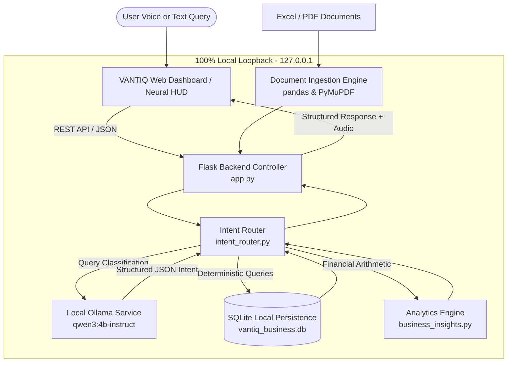

# VANTIQ — AI-Powered Business Intelligence Assistant

<p align="center">
  <strong>Your Business. Your Data. Your Intelligence.</strong><br>
  <em>A 100% locally hosted, privacy-first AI assistant for product pricing, inventory tracking, financial analytics, and natural-language intelligence.</em>
</p>

<p align="center">
  
  
  
  
  
  
</p>

---

## 1. Project Title & Introduction

**VANTIQ — AI-Powered Business Intelligence Assistant** is a desktop and browser-based business intelligence suite designed for business owners, inventory managers, and financial analysts. Operating entirely within your local network or workstation, VANTIQ combines high-precision spreadsheet/PDF parsing, relational SQLite inventory ledgers, deterministic financial calculations, and an offline Large Language Model (**Ollama** running `qwen3:4b-instruct`) for natural language and voice interaction.

---

## 2. Problem Statement & Project Objectives

### The Problem
- **Privacy and Data Leaks**: Modern cloud AI tools require businesses to transmit confidential financial spreadsheets, supplier price lists, margin figures, and internal documents to third-party servers.
- **Unpredictable API Costs**: Recurring token fees and subscription models create escalating operating expenses for small and mid-sized enterprises.
- **Hallucination in Business Math**: Generative AI models frequently fabricate numerical facts, produce inaccurate sums, or misquote product prices when answering business questions.
- **Fragmented Systems**: Businesses typically maintain disconnected tools for inventory management, document reading, report generation, and executive querying.

### Project Objectives
1. **100% Data Sovereignty**: Execute all ingestion, persistence, analytics, and AI reasoning locally without sending any data over the public internet.
2. **Zero Cloud API Subscriptions**: Utilize local open-weights AI (`qwen3:4b-instruct` via Ollama) with zero ongoing API costs.
3. **Deterministic Arithmetic**: Never allow LLMs to calculate business numbers. The LLM translates user queries into structured parameters, while mathematical formulas and SQL queries execute deterministically.
4. **Unified Business HUD**: Provide a real-time, responsive cyber-HUD dashboard supporting voice commands, interactive spreadsheets, catalogue ledgers, and automated export.

---

## 3. Key Features

### Implemented Features
- **Local AI Neural Core**:
  - Offline Ollama integration bound strictly to `127.0.0.1:11434`.
  - Intent interpretation into canonical JSON schemas (`product_list`, `product_stock`, `product_price`, `low_stock_products`, `dataset_filter`, `explanation`, etc.).
  - Educational explanation generator supporting Hindi (Devanagari), English, French, and Spanish.
  - Resilient automatic fallback: if Ollama is cold-starting or offline, the deterministic pattern engine answers queries seamlessly.
- **Product Catalogue & Inventory Ledger**:
  - Full CRUD operations with SQLite persistence and versioned schema migrations.
  - Strict stock preservation: metadata edits (name, category, price) cannot mutate inventory balances; stock changes require signed audit movements.
  - Low-stock and out-of-stock threshold monitoring with real-time HUD telemetry.
  - Spreadsheet dataset import with automated column mapping, preview, and deduplication policies (`skip_existing`, `update_permitted_fields`).
- **Dataset Intelligence & Analytics**:
  - Ingestion of multi-sheet Excel workbooks (`.xlsx`, `.xls`) and PDF documents.
  - Automated column classification (numeric, categorical, datetime, text).
  - Data quality audits (missing values, duplicate rows, anomalies, health score).
  - Automated KPI computations: gross revenue, average selling price, cost of goods sold, gross margin percentage, category breakdowns, and top suppliers.
- **Multi-Format Export Dossiers**:
  - Export executive dossiers in standalone interactive HTML, formatted CSV, or raw JSON.
- **Neural Cyber-HUD Web Dashboard**:
  - Real-time hardware and AI telemetry (CPU, RAM, DB Status, Ollama Health, Latency).
  - Hands-free voice recognition with Web Speech API and voice synthesis.
  - Interactive product search, live filters, and inventory ledger modal.

### Planned Features
- Multi-location warehouse inventory tracking.
- Barcode / QR-code camera scanner for instant stock adjustments.
- Automated email dispatch of daily low-stock digests via local SMTP.
- Native desktop installer packaging (MSI / PyInstaller).

---

## 4. Architecture Overview



---

## 5. Technology Stack

- **Backend Framework**: Python 3.10+, Flask 2.3+, Werkzeug
- **Database**: SQLite 3 with atomic transactions, foreign keys, and WAL mode
- **Data Science & Parsing**: pandas, openpyxl, xlrd, PyMuPDF (fitz)
- **Local AI Runtime**: Ollama daemon (REST loopback on `127.0.0.1:11434`)
- **Default LLM**: `qwen3:4b-instruct` (4-billion parameter instruction-tuned model)
- **Frontend**: Vanilla ES6+ JavaScript, CSS3 Design System with dark cyan cyber-HUD aesthetics, HTML5 Semantic Markup
- **Voice & Speech**: Web Speech Recognition API & Web SpeechSynthesis
- **Test Automation**: Python standard `unittest` framework

---

## 6. How Local AI Works Through Ollama

1. **Strict Loopback Binding**: All AI calls target `http://127.0.0.1:11434/api/chat` or `/api/tags`. External cloud AI domains (`api.openai.com`, `anthropic.com`, etc.) are prohibited and intercepted.
2. **Intent Extraction Only**: When a user asks *"What is the current stock of Laser Emitter Alpha?"*, the local LLM parses the sentence into:
   ```json
   {
     "intent": "product_stock",
     "entity": "Laser Emitter Alpha",
     "operation": "query"
   }
   ```
3. **Deterministic Retrieval**: The Intent Router receives the structured intent and issues an exact query against SQLite:
   ```sql
   SELECT quantity_on_hand, unit, reorder_level FROM products WHERE name LIKE '%Laser Emitter Alpha%' AND is_active = 1;
   ```
4. **Zero Hallucination**: The LLM never synthesizes numbers. Stock counts, prices, margins, and totals originate purely from verified database records.
5. **Cold-Start Resilience**: If Ollama is cold-loading into GPU/RAM, VANTIQ's Intent Router handles timeouts gracefully and falls back to deterministic regex pattern matching.

---

## 7. Data Flow: From Document to User Response

1. **Ingestion**: User drops an `.xlsx` or `.pdf` file onto the dashboard drop zone (`POST /api/data-import`).
2. **Profiling & Quality Check**: `business_insights.py` detects worksheet structure, normalizes headers, calculates missing rates, and identifies commercial columns (Product, Cost, Price, Quantity).
3. **Persistence**: The file metadata, raw records, and initial analysis are committed to SQLite under a unique SHA-256 hash.
4. **Catalogue Mapping**: Users can map spreadsheet columns to the product catalogue (`POST /api/datasets/<id>/product-import/commit`) with duplicate handling policies.
5. **Interactive Querying**: When the user enters a query in the console or speaks via microphone, VANTIQ resolves the query against the active dataset or product catalogue and displays structured cards, tables, or charts.

---

## 8. Project Directory Structure

```text
VANTIQ/
├── app.py                      # Main Flask application and REST API endpoints
├── business_insights.py        # Analytics engine, data profiling, metric formulas, and dossier export
├── database.py                 # SQLite persistence layer, schema migrations, and inventory ledger
├── dataset_intelligence.py     # Tabular intelligence helpers and column classifiers
├── intent_router.py            # Natural language router, intent dispatcher, and query builders
├── local_llm.py                # Local Ollama client, health monitor, and explanation generator
├── test_all.py                 # Comprehensive automated test suite (99 test cases)
├── requirements.txt            # Python package dependencies
├── .env.example                # Sample environment configuration template
├── .gitignore                  # Git repository exclusion rules
├── CHANGELOG.md                # Release notes and version history
├── CONTRIBUTING.md             # Developer contribution guidelines
├── instance/                   # Local SQLite database directory (git-ignored)
│   └── vantiq_business.db
├── web/                        # Web dashboard assets
│   ├── index.html              # Cyber-HUD dashboard interface
│   ├── style.css               # Styling, dark cyan themes, animations, and typography
│   └── app.js                  # Frontend controllers, speech recognition, and telemetry polling
└── UI/                         # Visual assets, HUD animations, and icons
```

---

## 9. System Requirements & Prerequisites

- **Operating System**: Windows 10/11 (64-bit), Linux (Ubuntu 20.04+), or macOS (12+)
- **Python**: Version 3.10, 3.11, or 3.12
- **Memory (RAM)**: Minimum 8 GB (16 GB recommended for running Ollama comfortably)
- **Disk Space**: 500 MB for Python environment + 3 GB for Ollama `qwen3:4b-instruct` model weights
- **Ollama**: Installed and running locally on port 11434

---

## 10. Step-by-Step Installation Instructions (Windows)

### 1. Clone the Repository
Open PowerShell or Command Prompt:
```powershell
git clone https://github.com/ayushrajcodes0407/VANTIQ.git
cd VANTIQ
```

### 2. Set Up a Virtual Environment
```powershell
python -m venv .venv
.venv\Scripts\Activate.ps1
```

### 3. Install Python Dependencies
```powershell
python -m pip install --upgrade pip
pip install -r requirements.txt
```

---

## 11. Ollama Installation & Model Setup

1. **Download Ollama**: Visit [https://ollama.com/download](https://ollama.com/download) and install Ollama for Windows.
2. **Verify Service is Running**:
   In PowerShell:
   ```powershell
   curl http://127.0.0.1:11434/api/tags
   ```
   You should receive a JSON response indicating Ollama is online.
3. **Download the Recommended Model**:
   ```powershell
   ollama pull qwen3:4b-instruct
   ```
4. **Test the Model Locally**:
   ```powershell
   ollama run qwen3:4b-instruct "Hello, are you operational?"
   ```

---

## 12. Configuration (.env.example)

Copy `.env.example` to `.env` if you wish to customize port or model paths:
```powershell
Copy-Item .env.example .env
```

Key configuration parameters:
| Variable | Default Value | Description |
| :--- | :--- | :--- |
| `PORT` | `5000` | HTTP port for the Flask server |
| `JARVIS_DB_PATH` / `VANTIQ_DB_PATH` | `instance/vantiq_business.db` | Path to SQLite database |
| `OLLAMA_BASE_URL` | `http://127.0.0.1:11434` | Ollama loopback URL |
| `OLLAMA_MODEL` | `qwen3:4b-instruct` | Configured local LLM model name |
| `ENABLE_LOCAL_LLM` | `true` | Toggle local AI intent router |

---

## 13. Database Initialization & Sample Data

The database initializes automatically on the first application launch:
```powershell
python -c "import database; database.init_db(); print('Database initialized successfully.')"
```
To populate sample products and inventory lines, you can run the test suite or import any sample spreadsheet via the web interface.

---

## 14. Running the Application

Start the VANTIQ backend server:
```powershell
python app.py
```
Expected terminal output:
```text
==================================================
 VANTIQ: AI-Powered Business Intelligence Assistant
 Your Business. Your Data. Your Intelligence.
 Running locally at http://127.0.0.1:5000
==================================================
```
Open your browser and navigate to:
**[http://127.0.0.1:5000](http://127.0.0.1:5000)**

---

## 15. Verified API Reference

| Method | Endpoint | Description |
| :--- | :--- | :--- |
| `GET` | `/` | Serves main VANTIQ Neural HUD Dashboard |
| `GET` | `/api/status` | Live system telemetry (CPU, RAM, Date, Time, Local AI Health) |
| `GET` | `/api/llm/status` | Real-time Ollama daemon and model availability check |
| `POST` | `/api/command` | Natural language and voice intent query router |
| `POST` | `/api/data-import` | Uploads and analyzes Excel (`.xlsx`, `.xls`) or PDF documents |
| `GET` | `/api/bi-report` | Retrieves the active business intelligence report |
| `GET` | `/api/export-report?format=html\|csv\|json` | Downloads formatted intelligence report |
| `GET` | `/api/datasets` | Paginated list of saved datasets |
| `GET` | `/api/datasets/<id>` | Retrieves dataset metadata, sheets, and summary |
| `GET` | `/api/datasets/<id>/records` | Paginated tabular records for a dataset |
| `POST` | `/api/datasets/<id>/open` | Activates a saved dataset in the workspace |
| `POST` | `/api/datasets/<id>/analyze` | Re-executes analytics engine on saved dataset |
| `GET` | `/api/products` | Filterable, searchable, paginated product list |
| `POST` | `/api/products` | Registers new product with atomic opening balance |
| `PATCH` | `/api/products/<id>` | Updates permitted fields (name, category, price, reorder level) |
| `POST` | `/api/products/<id>/stock-adjustment` | Records stock audit movement (in, out, count, loss) |
| `POST` | `/api/products/<id>/deactivate` | Soft deactivation (retains audit ledger) |
| `GET` | `/api/inventory/summary` | Inventory KPIs (valuation, active items, stock counts) |
| `GET` | `/api/inventory/alerts/low-stock` | Products at or below reorder threshold |
| `POST` | `/api/datasets/<id>/product-import/preview` | Spreadsheet column mapping preview & validation |
| `POST` | `/api/datasets/<id>/product-import/commit` | Commits spreadsheet rows into catalogue with deduplication |

---

## 16. Example Natural Language Queries

Users can type or speak any of the following queries:

### Product Catalogue & Pricing
- *"Show all products"*
- *"How many products do we have?"*
- *"What is the selling price of Laser Emitter Alpha?"*
- *"What is the purchase cost of Guidance Gyro Beta?"*
- *"Which products have no selling price?"*
- *"Find Product Laser"*

### Stock & Inventory Tracking
- *"What is the current stock of Laser Emitter Alpha?"*
- *"Which products are low in stock?"*
- *"Show products with low stock"*
- *"Show all out-of-stock items"*
- *"Check inventory summary"*

### Business Intelligence & Datasets
- *"Explain the findings"*
- *"What is the total revenue?"*
- *"Show sales trends"*
- *"Which products have the highest margin?"*
- *"Show missing values in this dataset"*

### Multilingual & Conceptual Accounting
- *"Explain gross margin in Hindi"*
- *"Explain reorder level in Hindi"*
- *"Define gross margin in English"*
- *"Explain gross margin in French"*

---

## 17. Running Automated Tests

VANTIQ includes a complete 99-test regression and feature validation suite in `test_all.py`:

```powershell
# Run the complete test suite
python -m unittest test_all.py

# Run Step 5 Local LLM tests specifically (tests 90-99)
python -m unittest test_all.JarvisFullTestSuite.test_90_ollama_health_check_endpoint test_all.JarvisFullTestSuite.test_91_llm_show_all_products_returns_actual_names test_all.JarvisFullTestSuite.test_92_llm_product_count_returns_actual_count test_all.JarvisFullTestSuite.test_93_llm_low_stock_products_returns_matching_stock_rules test_all.JarvisFullTestSuite.test_94_llm_selling_price_retrieves_actual_stored_price test_all.JarvisFullTestSuite.test_95_llm_explain_gross_margin_in_hindi test_all.JarvisFullTestSuite.test_96_voice_and_typed_parity_through_intent_router test_all.JarvisFullTestSuite.test_97_invalid_model_json_safe_fallback test_all.JarvisFullTestSuite.test_98_unavailable_ollama_service_triggers_safe_fallback test_all.JarvisFullTestSuite.test_99_zero_cloud_ai_dependencies_and_loopback_isolation
```

---

## 18. Privacy, Security & Local Deployment

- **Zero Cloud AI Leakage**: No prompts, spreadsheet contents, financial records, or credentials ever leave your machine.
- **Hardware Isolation**: The network request guard strictly enforces `127.0.0.1` and `localhost`. External URLs are blocked by architecture.
- **Sanitized SQL Execution**: Database interactions utilize parameterized queries throughout, mitigating SQL injection risks.
- **Local SQLite Storage**: All datasets, reports, and product catalogs reside in `instance/vantiq_business.db` under your control.

---

## 19. Troubleshooting

### 1. Ollama status says "STANDBY" or "OFFLINE"
- Ensure Ollama is running in your taskbar or terminal (`ollama list`).
- Verify that `qwen3:4b-instruct` has been downloaded (`ollama pull qwen3:4b-instruct`).
- In `http://127.0.0.1:5000`, the Local AI HUD card displays real-time connection status.

### 2. High latency on first query
- The first query after launching Ollama may take 10–20 seconds as the model weights load from disk into memory. Subsequent queries complete in 1–4 seconds.

### 3. Microphone not recognized
- Ensure your browser has microphone permission for `http://127.0.0.1:5000`.
- In Chromium-based browsers, Web Speech recognition requires an active audio input device.

---

## 20. Known Limitations & Roadmap

- **Single-Node Persistence**: Designed for single-server or single-workstation local deployment using SQLite. Distributed multi-server clustering requires PostgreSQL migration.
- **Model Size vs. Hardware**: While `qwen3:4b-instruct` runs smoothly on modern multi-core CPUs and consumer GPUs, low-spec dual-core laptops may experience higher query latency.
- **Upcoming Milestone**: Multi-currency auto-conversion and PDF scanned document OCR support (Tesseract integration).

---

## 21. Contribution Guidelines

Contributions are welcome! Please review [CONTRIBUTING.md](CONTRIBUTING.md) for details on code style, testing requirements, and pull request procedures.

---

## 22. License & Ownership

This project is licensed under the MIT License. See [LICENSE](LICENSE) for full legal text.

Copyright (c) 2026 Ayush Raj ([@ayushrajcodes0407](https://github.com/ayushrajcodes0407)). All rights reserved.

---

<p align="center">
  <strong>VANTIQ — AI-Powered Business Intelligence Assistant</strong><br>
  <em>Your Business. Your Data. Your Intelligence.</em>
</p>
